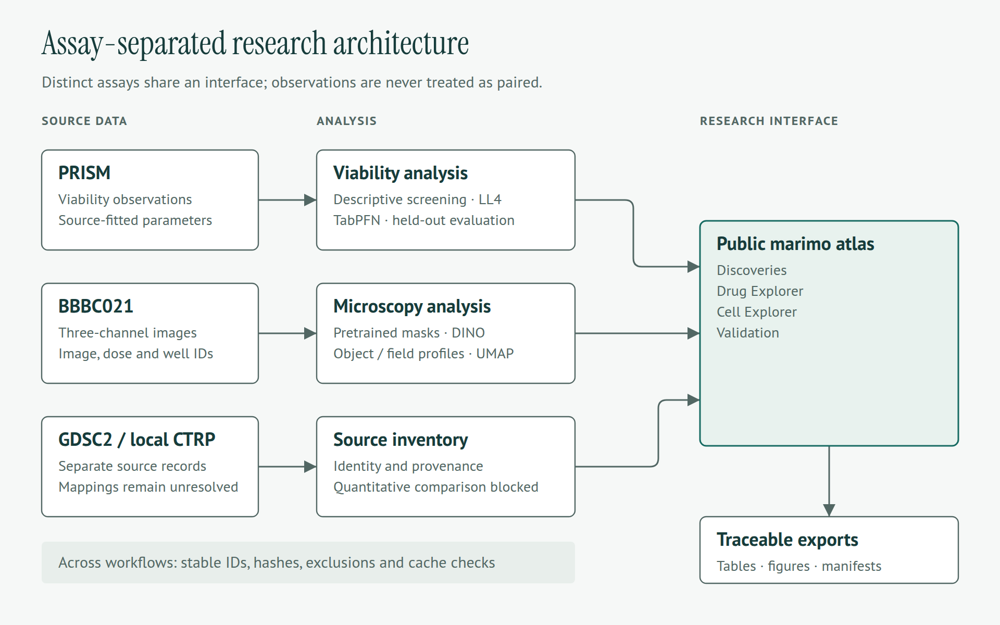
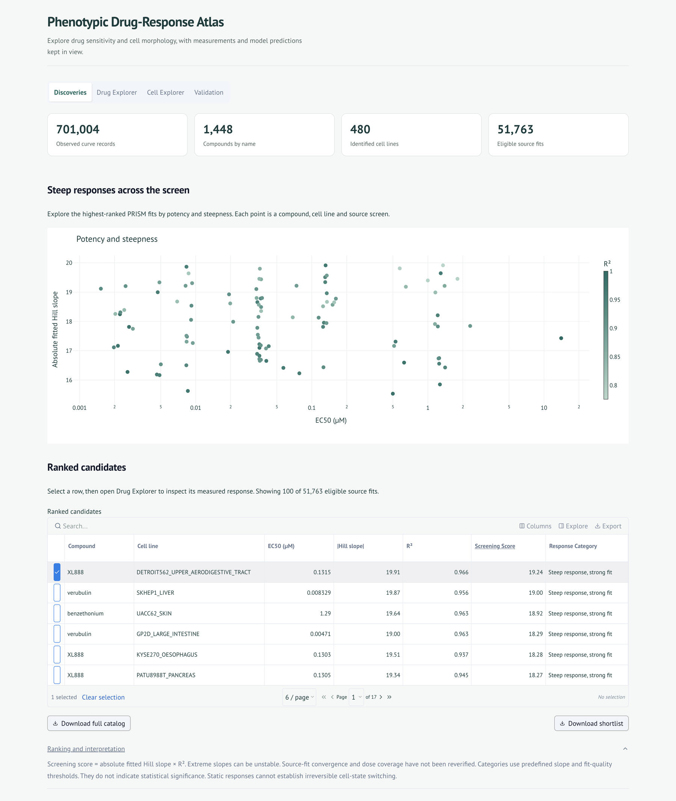
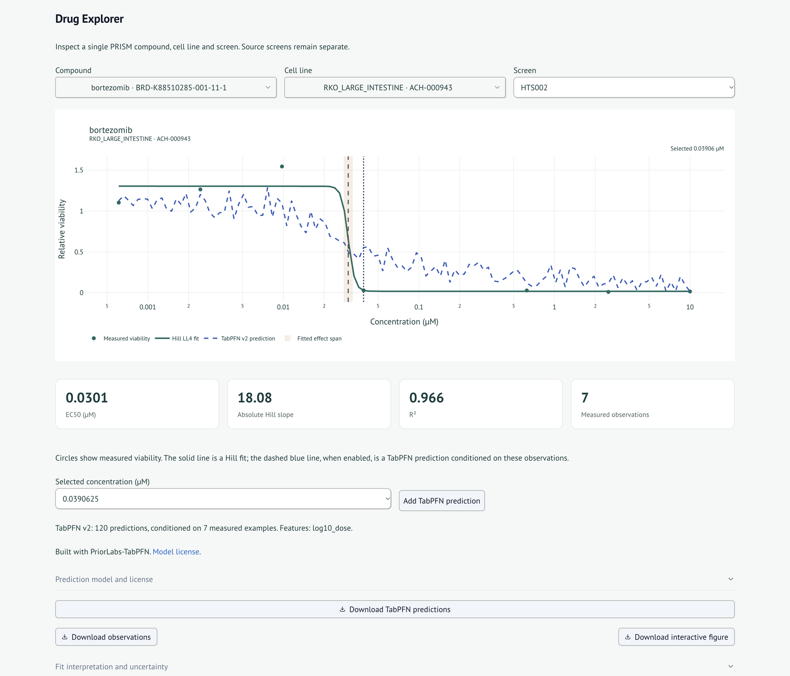
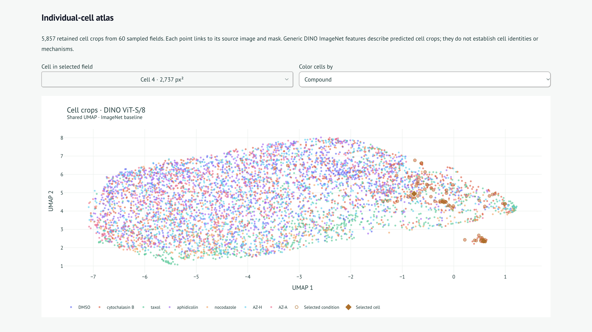
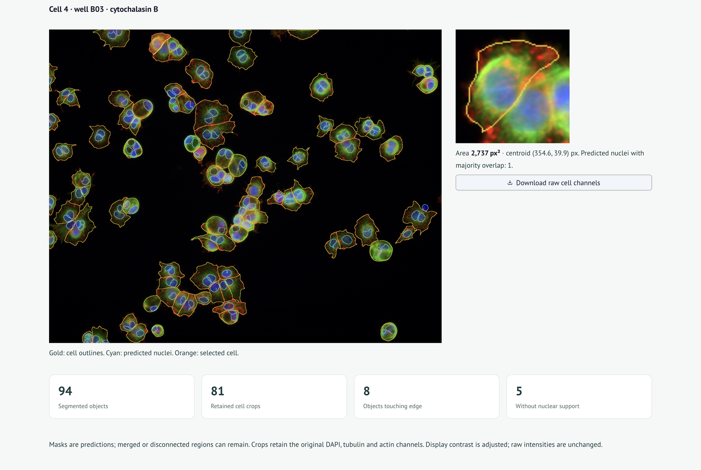
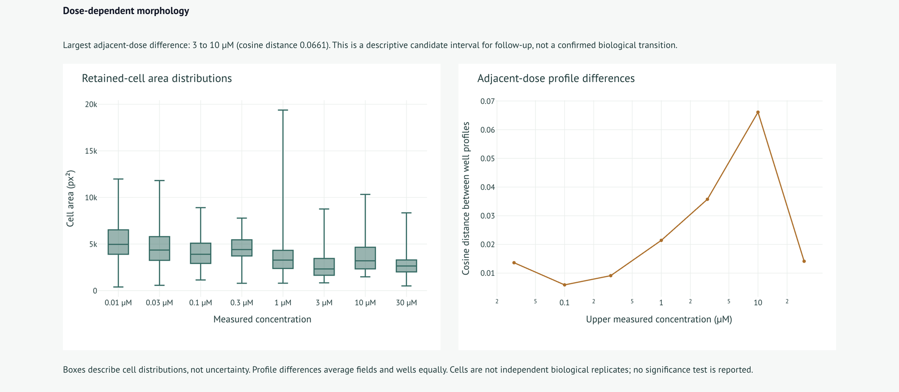
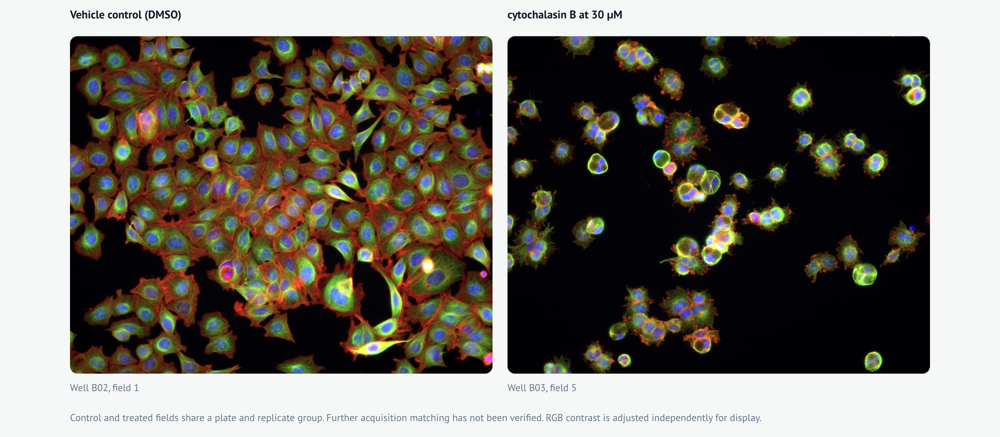
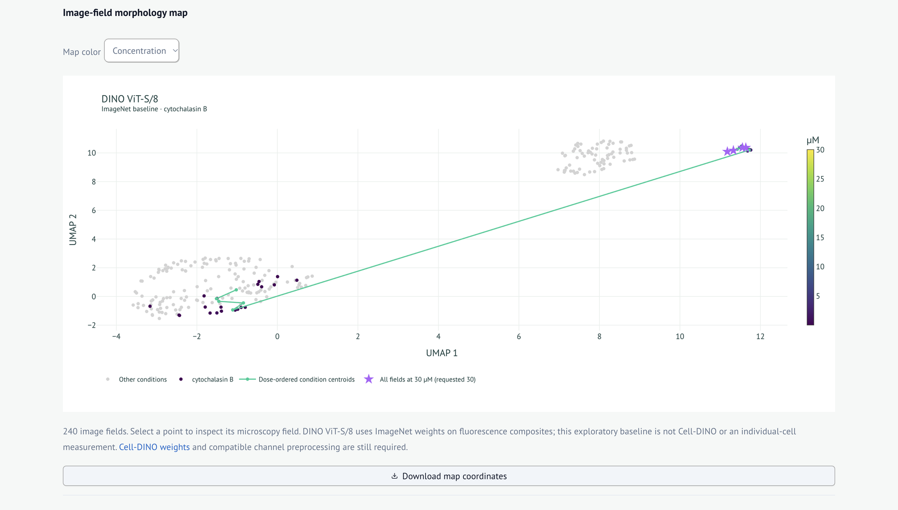
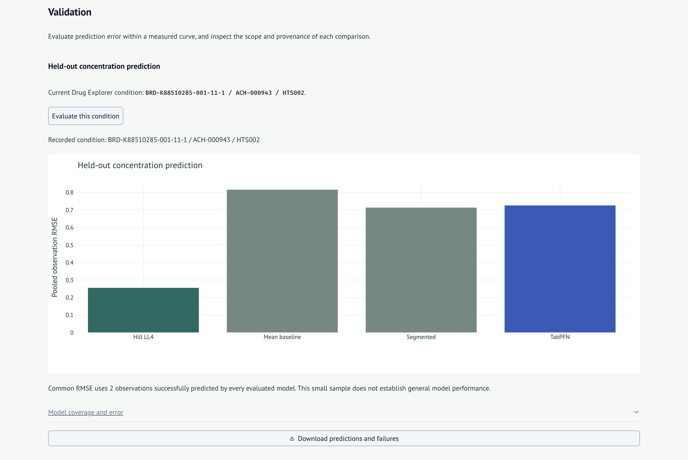

# Phenotypic Drug-Response Atlas

Explore cancer-drug responses and cell morphology in a [marimo](https://marimo.io/) application. Rank steep viability responses, compare measured data with pretrained predictions, and inspect microscopy changes across doses.

[Application](https://curriculum-consequence-economics-amanda.trycloudflare.com) · [Methods](METHODS.md) · [Setup details](CONFIGURATION.md) · [Data provenance](DATA_PROVENANCE.md) · [Test results](TEST_RESULTS.md)

## How it works

PRISM measurements feed screening, Hill fits and TabPFN predictions. BBBC021 images feed segmentation, DINO embeddings and morphology maps. Both workflows feed the atlas and traceable exports; their measurements remain separate. External datasets currently provide source inventories only.



[Architecture source](assets/readme/architecture.mmd) · [SVG](assets/readme/architecture.svg) · [HTML](assets/readme/architecture.html)



## Features

### Discoveries

Rank PRISM source fits by absolute Hill slope × R². Inspect the top 100 candidates; export the full eligible catalog.

### Drug Explorer

Select a compound, cell line and screen. Compare observations, Hill fits and TabPFN v2 predictions conditioned on that curve. Export measurements, predictions and figures.



### Cell Explorer

Explore linked cell and image-field UMAPs, microscopy overlays and dose comparisons. Cellpose-SAM predicts cell masks; InstanSeg supplies nuclear predictions; generic DINO supplies image features.











### Validation

Evaluate held-out concentrations, inspect failures, and review source records and methods. Quantitative GDSC2/CTRP comparisons remain unavailable.



## Run locally

Requires Python 3.13+ and [uv](https://docs.astral.sh/uv/). Run from the repository root:

```sh
uv sync --locked
uv run marimo run notebook.py
```

Experimental data, model weights and derived caches are not included in a fresh checkout. Download the configured PRISM files and one BBBC021 plate explicitly:

```sh
uv run python scripts/download_data.py
```

The downloader preserves existing files. Missing data or unverified caches produce unavailable states. The application does not download weights or train models automatically.

For TabPFN, DINO and segmentation, supply verified local weights and update machine-specific paths in `config/`. See [CONFIGURATION.md](CONFIGURATION.md) for checkpoint identities, licenses, preprocessing and inference commands. The recorded cell analysis used a GTX 1650 with 4 GB VRAM; CPU execution is supported.

## Results

Local counts were checked on **2026-10-27**. [Full counts and exclusions](assets/readme/verified-results.json).

| Analysis | Recorded scope |
| --- | --- |
| PRISM | 701,004 source curve rows; 1,502 compound IDs, 1,448 names and 480 identified cell lines |
| Screening | 51,763 eligible source fits; top 100 displayed |
| Image-field analysis | 240 BBBC021 fields; 384-dimensional generic DINO features |
| Cell-object analysis | 8,647 predicted objects; 5,857 retained and 2,790 excluded; 60 fields from 60 wells |

The [cell-atlas run](STEP19_RESULTS.md) processed one field per well, covering 60 of 240 available fields. GPU inference took **47.65 minutes**, with **2.47 GiB** peak process RAM and **2.30 GiB** peak GPU allocation, excluding driver memory. Pixel checks covered 180 crops; 258 retained masks contained disconnected regions. Segmentation accuracy remains unmeasured without matched manual labels.

Cytochalasin B showed its largest adjacent-dose profile difference between **3 and 10 μM**: cosine distance **0.0661**, with one sampled well per endpoint. This descriptive result identifies an interval for follow-up.

### Held-out concentration benchmark

The [recorded benchmark](reports/runs/step18-1-2026-10-26/) covers bortezomib/RKO, screen HTS002: **one curve, three folds, seven observations**.

| Model | Successful predictions | Failed folds | RMSE on own successes | RMSE on common observations |
| --- | ---: | ---: | ---: | ---: |
| Hill LL4 | 4/7 | 1/3 | 0.6629 | 0.2558 |
| Mean baseline | 7/7 | 0/3 | 0.7463 | 0.8168 |
| Segmented regression | 2/7 | 2/3 | 0.7143 | 0.7143 |
| TabPFN v2 | 7/7 | 0/3 | 0.5570 | 0.7267 |

Only **two observations** were predicted successfully by every model. Model-specific RMSE uses different successful subsets. These results do not establish general model superiority or performance on unseen drug–cell combinations.

## Methods and limits

PRISM log2 responses become relative viability through `2^response`; compound identifiers and source screens remain separate. Screening requires finite parameters, EC50 > 0, R² in [0.75, 1] and absolute slope in (1, 20]. Ranking is descriptive; source fits have not all been refitted or checked for convergence.

Selected curves use Thunor four-parameter Hill fits. TabPFN uses an explicit v2 checkpoint and log10 concentration. Evaluation holds out entire concentration groups and retains failed predictions. The EC20–EC80 span describes the fitted effect range, **not uncertainty**.

Microscopy uses DAPI, tubulin and actin channels. Predicted cell crops are embedded with frozen ImageNet DINO ViT-S/8 weights. Adjacent-dose comparisons use high-dimensional profiles with equal field/well weighting. UMAP is a visualization; its distances can be distorted.

Important limits:

- Steep responses and morphology differences do not prove irreversible biological tipping points or causal mechanisms.
- PRISM viability and BBBC021 morphology are separate, unpaired assays.
- Cells are not independent biological replicates. Valid confidence intervals and inferential transition tests are unavailable.
- Segmentation can merge or fragment cells; exclusions can bias populations. Optical calibration is missing, so spatial measurements use pixels.
- DINO features are exploratory. Cell-DINO and a quantitative CellProfiler baseline are unavailable.
- GDSC2 release 8.2 is authenticated, but reviewed PRISM mappings and comparable potency definitions are missing. Local CTRPv2 processing remains unverified; EC50 and IC50 are not assumed equivalent.

[Detailed methods](METHODS.md) · [Scientific audit](SCIENTIFIC_AUDIT.md) · [Remaining blockers](REMAINING_BLOCKERS.md)

## Reproducibility

Analyses record input/output hashes, checkpoint identities, preprocessing, software versions, seeds and code revision. Caches join by stable identifiers and reject mismatches. Reports retain exclusions and prediction failures; existing run directories are never overwritten.

[Evaluation diagram](assets/readme/evaluation.png) ([source](assets/readme/evaluation.mmd), [SVG](assets/readme/evaluation.svg), [HTML](assets/readme/evaluation.html))

```sh
uv run python -m unittest discover -s tests -v
uv run marimo check notebook.py
uv run python tests/validate_cell_atlas.py

uv run python -m analysis.run --output reports/runs/NEW_RUN \
  --compound-id BRD-K88510285-001-11-1 --cell-id ACH-000943 --screen HTS002
```

Add `--include-tabpfn` to the report command for configured pretrained evaluation. Real-data tests require local datasets and verified artifacts. Diagnostics are available through `uv run marimo edit dev_notebook.py` and `audit_notebook.py`.

[Recorded verification](TEST_RESULTS.md#step-19-final-execution-2026-10-26): **83 tests and 12 desktop interaction groups passed**, alongside notebook checks and execution. These are historical results. Browser-based verification and artifact reconciliation were recorded on 2026-10-27; the full suite was not rerun then. No mobile validation was performed.

## Sources and licenses

- **Data:** [PRISM](https://figshare.com/articles/dataset/Repurposing_Data_Portal/9393293) ([processing](https://github.com/broadinstitute/repurposing/blob/master/depmap_reprocessing_script_for_secondary.R)), [BBBC021](https://bbbc.broadinstitute.org/BBBC021), [GDSC2](https://ftp.sanger.ac.uk/pub/project/cancerrxgene/releases/release-8.2/), [CTRP](https://portals.broadinstitute.org/ctrp/). [Processed BBBC021 masks](https://zenodo.org/records/22763120) were inspected but not used because image mappings were unresolved.
- **Methods and models:** [Thunor](https://github.com/alubbock/thunor), [TabPFN](https://github.com/PriorLabs/TabPFN), [DINO](https://github.com/facebookresearch/dino), [InstanSeg](https://github.com/instanseg/instanseg), [Cellpose-SAM](https://github.com/MouseLand/cellpose), [UMAP](https://umap-learn.readthedocs.io/).

Built with PriorLabs-TabPFN. Review the [v2 weight license](https://huggingface.co/Prior-Labs/TabPFN-v2-reg/blob/main/LICENSE.txt) and other upstream licenses before redistribution. Cellpose code uses GPL-3.0; DINO and the inspected InstanSeg model identify Apache-2.0. No project-wide license is supplied. Full source and model provenance: [DATA_PROVENANCE.md](DATA_PROVENANCE.md).
