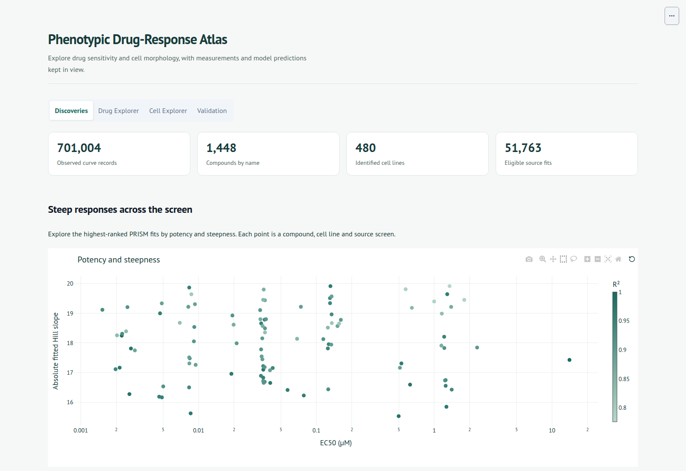
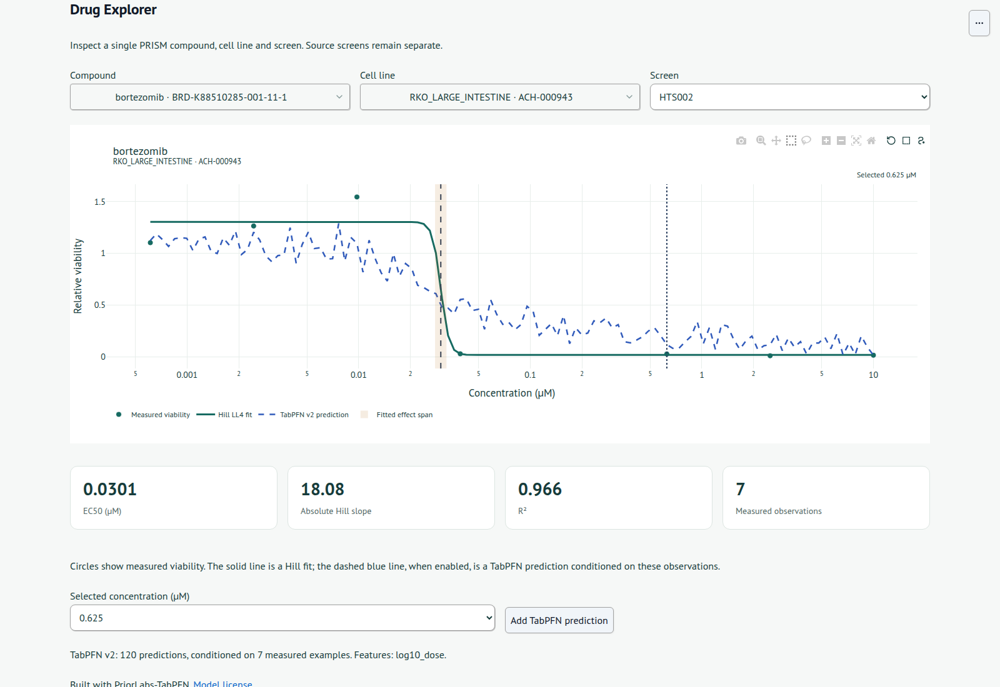
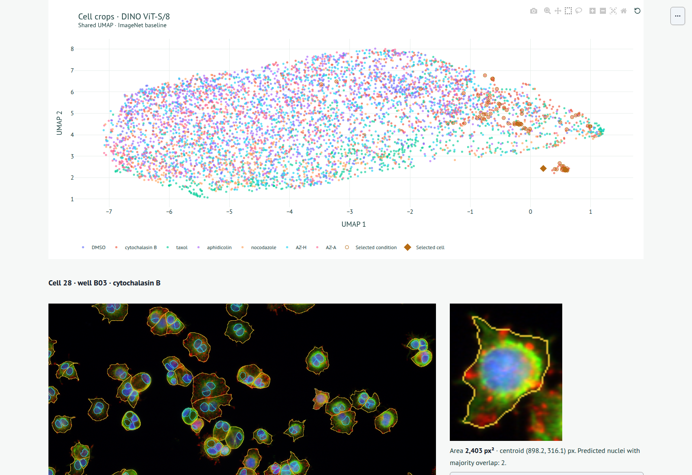
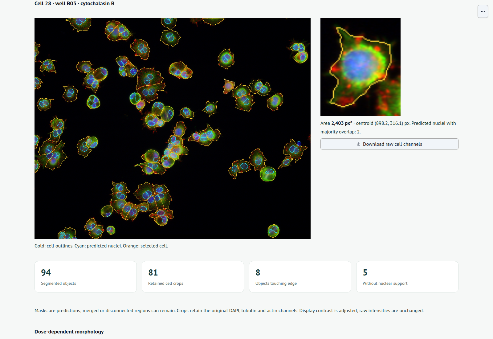
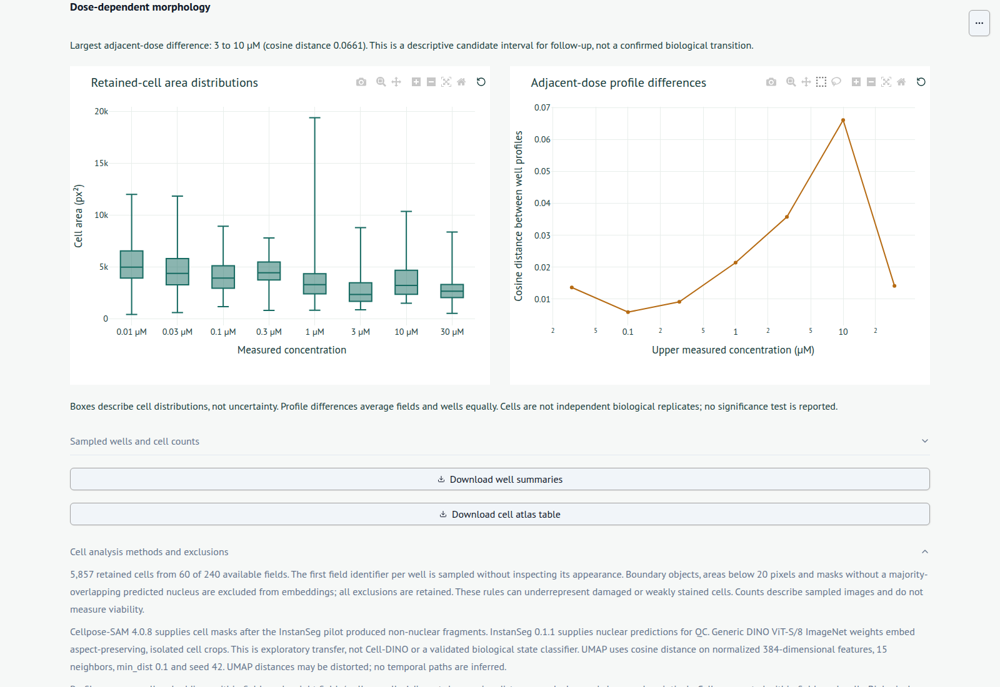
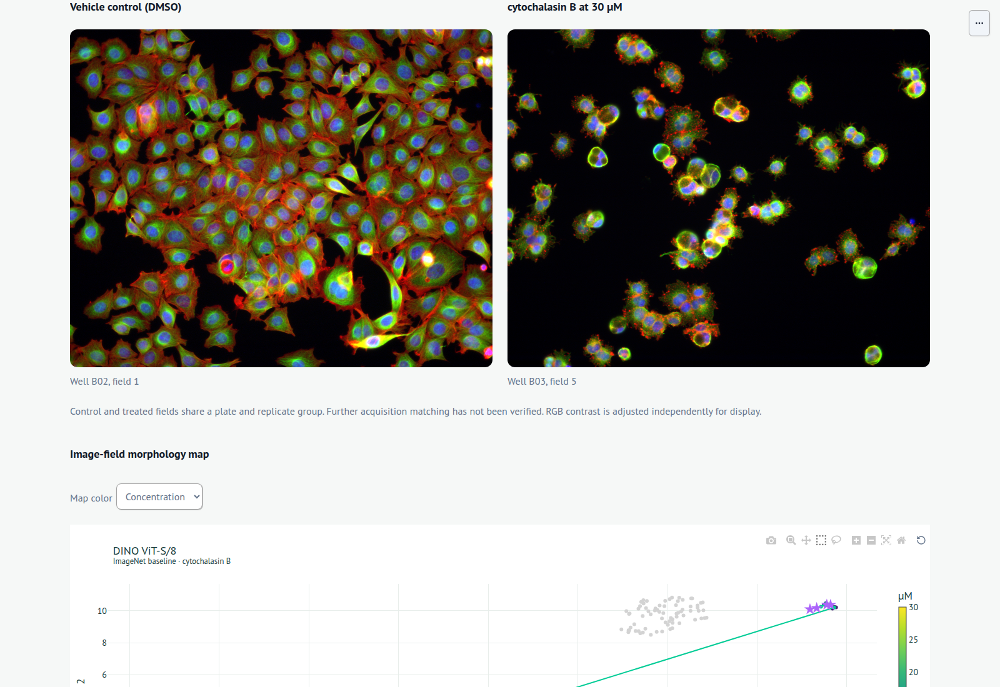
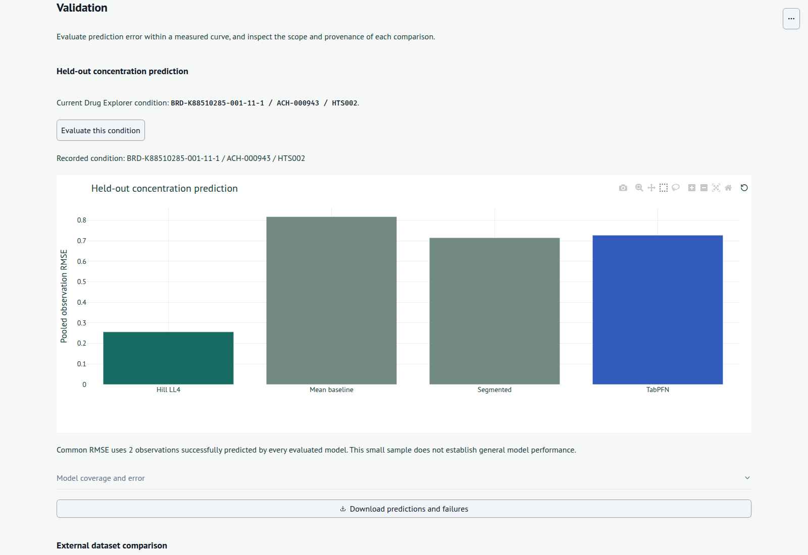
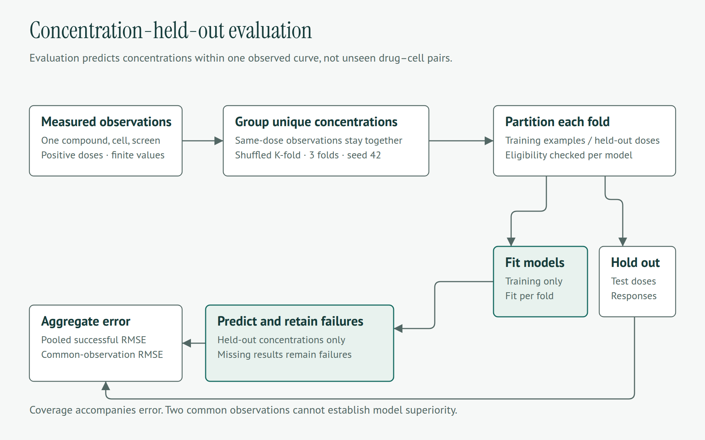

# Phenotypic Drug-Response Atlas

**Reproducible drug-response screening and microscopy exploration with pretrained AI.**

A research application for examining steep cancer-cell viability responses, predicting held-out concentrations, and exploring drug-associated morphology at image-field and segmented-object scales. The atlas connects observations, model outputs and source provenance in a reactive [marimo](https://marimo.io/) interface.

[Application](https://curriculum-consequence-economics-amanda.trycloudflare.com) · [Methods](METHODS.md) · [Scientific audit](SCIENTIFIC_AUDIT.md) · [Data provenance](DATA_PROVENANCE.md) · [Configuration](CONFIGURATION.md) · [Test evidence](TEST_RESULTS.md)

> **Research scope.** Steep dose responses and adjacent-dose morphology differences identify candidates for follow-up. They do not demonstrate irreversible switching, bistability, hysteresis or a causal transition mechanism. PRISM viability and BBBC021 microscopy remain separate assays. Generic DINO is used; Cell-DINO and quantitative external validation are currently unavailable.



## Research question and contributions

Drug screens describe how viability changes with concentration; microscopy describes cellular appearance after treatment. Both can reveal unusual responses, but their interpretation depends on sampling, model identifiability, experimental structure and source provenance. A sharp fitted response can reflect limited dose resolution as well as biology. A microscopy cluster can reflect acquisition or segmentation effects as well as phenotype.

The atlas asks three operational questions:

1. Which source-fitted viability curves combine high steepness with adequate descriptive fit quality?
2. How well do mathematical and pretrained models predict concentrations withheld from an observed curve?
3. Which dose intervals show the largest descriptive changes in microscopy-derived population profiles, and which source objects support those comparisons?

Its contributions are an auditable screening workflow, a concentration-grouped evaluation pipeline that retains failures, and a linked microscopy atlas with stable image/object identifiers. Pretrained TabPFN, InstanSeg, Cellpose-SAM and DINO provide inference without task-specific weight training. The contribution is their traceable integration and evaluation; this repository does not introduce a new foundation model or establish a biological tipping-point mechanism.

## Current evidence

The following counts were recomputed from local files on **2026-10-27**; benchmark and atlas loaders also checked manifests and output integrity. Full values and sequential exclusions: [verified-results.json](assets/readme/verified-results.json).

| Quantity | Observed value | Definition |
| --- | ---: | --- |
| PRISM source curve rows | 701,004 | Rows of `curves.csv`, including rows with unresolved cell identifiers |
| Compound identifiers / display names | 1,502 / 1,448 | Distinct BRD identifiers / nonmissing names; names are not unique chemical identities |
| Identified cell lines | 480 | Nonmissing DepMap identifiers in the curve table |
| Compound–cell pairs / compound–cell–screen groups | 644,798 / 690,192 | Distinct groups after requiring compound and cell identifiers |
| Nonmissing response-matrix values | 14,527,780 | Stored response entries, before per-condition validity exclusions |
| Eligible source fits | 51,763 | Application-defined finite-parameter, potency, slope and R² filters |
| Public candidate shortlist | 100 | Highest screening scores from the full eligible catalog |
| BBBC021 image-field embeddings | 240 × 384 | One local MCF-7 plate; generic DINO features |
| Single-cell atlas | 5,857 retained objects | 60 fields from 60 wells; 60 of 240 available fields sampled |

These are local dataset counts, not a claim that every source fit was independently refitted or every predicted object is one correctly segmented cell.

## Application features

### Discoveries: descriptive candidate screening

A potency-versus-steepness plot shows the 100 highest-ranked eligible source fits, colored by R². Hover reveals compound, cell line, potency and screening score. The searchable, sortable, paginated table links a selected row to Drug Explorer's compound, cell line and screen. Full-catalog and shortlist CSV exports retain identifiers.

**Screening score = |fitted Hill slope| × R².** This heuristic prioritizes steep, well-fitting source curves; it has no calibrated probability or significance interpretation and can favor unstable extreme slopes.

| Response category | Predefined descriptive thresholds |
| --- | --- |
| Steep response, strong fit | \|slope\| ≥ 2 and R² ≥ 0.90 |
| Steep response, moderate fit | \|slope\| ≥ 2 and 0.75 ≤ R² < 0.90 |
| Other qualifying fit | Remaining eligible source fits |

Categories do not indicate statistical significance. Source-fit convergence and transition coverage remain unverified; selected-condition refits are separate calculations.

### Drug Explorer: observations, fits and conditioned prediction

Searchable compound and cell-line selectors and a source-screen selector identify one PRISM condition. Changing a compound rebuilds compatible choices. The chart distinguishes measured viability, a fitted four-parameter Hill curve and an optional dashed TabPFN prediction. A concentration cursor changes annotations independently of model inference.



The **Add TabPFN prediction** button performs real pretrained inference on 120 concentrations, conditioned on the selected curve's valid observations. Model identity, checkpoint hash and dose features accompany prediction exports. It is within-curve prediction, not zero-shot evidence or prediction for unseen drug–cell combinations. Model errors leave observations and available Hill fits visible.

Fit metrics include EC50, absolute slope, R² and observation count. The amber EC20–EC80 span describes inhibition relative to fitted asymptotes; it is **not a confidence interval**. Fit diagnostics and uncertainty limitations are available in a disclosure. Downloads include raw selected observations, predicted values and an interactive HTML figure; Plotly's toolbar exports SVG figures and provides zoom, pan and reset controls.

### Cell Explorer: linked cell objects and image fields

BBBC021 compound, concentration and image-field selectors operate independently of PRISM. The single-cell map projects all 5,857 retained crop embeddings into a shared UMAP. Color modes show compound, dose, cell area or nuclear fraction; point selection resolves stable cell IDs to the corresponding compound, concentration, source field and crop. A searchable object selector provides another route to the same evidence.



The field viewer overlays predicted cell and nuclear boundaries, highlights the selected object, and displays a fluorescence crop. QC cards report segmented objects, retained crops, boundary objects and objects without nuclear support. Raw three-channel TIFF export preserves original uint16 intensities; the cell table includes image ID, mask label, coordinates, bounding box, dose, well, replicate and atlas-manifest identity.



Dose-wise area distributions and adjacent-dose feature-profile differences support descriptive population comparisons. Well summaries and the complete cell atlas are downloadable. Cells are nested within fields/wells; they are not treated as independent biological replicates.



**Image-field analysis remains available separately.** Its disclosure contains a same-plate/replicate DMSO comparison, a 240-field UMAP with compound/dose coloring, field selection, dose-ordered centroids and coordinate export. Control matching beyond available metadata is unverified. Lines joining static dose centroids do not represent time trajectories. [View the complete image-field map](assets/readme/image-field-map.png).



### Validation: evaluation, coverage and provenance

The Validation view displays a verified recorded benchmark or runs concentration-held-out evaluation for the current Drug Explorer condition. It exposes model coverage/failures, common-observation RMSE, fold-level prediction export, external-source inventories, methods, citations and evaluation scope.



External comparison infrastructure validates source files, identifier crosswalks, units, censoring, quality and potency definitions. Its matching and stratified Spearman calculations are implemented and tested, but **no configured empirical cross-dataset comparison currently passes the required evidence checks**. Consequently, correlations, intervals and replication classifications are not displayed as findings. [View the live source-inventory state](assets/readme/external-evidence.png).

Development diagnostics remain in `dev_notebook.py`; `audit_notebook.py` preserves detailed tables and exclusion inspection outside the four-tab public interface. Historical unverified experiments and reports remain quarantined in `legacy/unverified/`.

## Methodology

### 1. Source observations and identifiers

PRISM response-matrix columns join one-to-one to treatment identifiers. Compound BRD ID, cell DepMap ID and screen ID define a condition; wells, detection plates and source column identities remain attached. Missing/invalid values receive recorded exclusions. Source screens and distinct BRD identifiers are never pooled silently.

The documented transformation is:

$$v = 2^r,$$

where $r$ is the stored log2 response and $v$ is relative viability. Values above one are retained. The convention follows the [Broad secondary-screen reprocessing script](https://github.com/broadinstitute/repurposing/blob/master/depmap_reprocessing_script_for_secondary.R).

Catalog inclusion requires complete identifiers, finite parameters, EC50 > 0, 0.75 ≤ R² ≤ 1 and 1 < |slope| ≤ 20. Sequential filtering removes 10,812 identifier-incomplete rows, 632,384 rows outside the R² interval and 6,045 outside the slope interval, leaving 51,763. These thresholds are screening policy, not inferential evidence.

### 2. Four-parameter nonlinear fitting

The selected condition uses Thunor `HillCurveLL4` and SciPy nonlinear least squares:

$$y(x)=L+\frac{U-L}{1+\exp\{h[\ln(x)-\ln(EC_{50})]\}}.$$

$L,U$ are fitted asymptotes, $h$ is the positive slope convention, and $EC_{50}$ is the midpoint of the fitted response span. At least four distinct positive concentrations and five finite observations are required. Constant responses, invalid parameters, degenerate asymptotes and failed optimization return explicit failure states without invented predictions.

$$R^2=1-\frac{\sum_i(y_i-\hat y_i)^2}{\sum_i(y_i-\bar y)^2},\qquad
\mathrm{RMSE}=\sqrt{\frac{1}{n}\sum_i(y_i-\hat y_i)^2}.$$

Negative R² is retained; constant-response R² is undefined. For a decreasing curve, $EC_{20}=EC_{50}(0.25)^{1/h}$ and $EC_{80}=EC_{50}4^{1/h}$. Extrapolated effect spans, sparse transition sampling, extreme slopes and ill-conditioned parameter Jacobians generate cautions. Perturbation stability and valid confidence intervals have not been established.

### 3. Pretrained tabular inference and held-out evaluation

TabPFN v2 uses a pinned local checkpoint, CPU inference, seed 42, `low_memory` conditioning and the configured `log10(dose)` feature. The Python package version, 9.2.0, is distinct from the checkpoint's v2 release identity. Configuration never selects a different model based on authentication; checkpoint/version mismatches disable inference. A two-feature option is implemented but has not been compared experimentally.

Evaluation uses shuffled three-fold K-fold splitting of **distinct concentrations**, seed 42. All observations at a held-out concentration stay together. Each model receives only training observations; no full-data fit defines a transition-zone evaluation region. Models comprise Hill LL4, a separate mean-training-response baseline, one-breakpoint segmented regression on log10 dose, and configured TabPFN. Failed fits produce missing predictions with reasons; segmented failures are never replaced by a hidden baseline.



[Mermaid source](assets/readme/evaluation.mmd) · [SVG](assets/readme/evaluation.svg) · [Self-contained HTML](assets/readme/evaluation.html)

### 4. Pretrained microscopy analysis

The raw BBBC021 channels are DAPI, tubulin and actin. Display composites map actin→red, tubulin→green and DAPI→blue, with 1st/99.5th-percentile contrast adjustment. Original intensities remain unchanged.

Image-field embeddings resize the composite's short edge to 256, center-crop to 224, apply ImageNet normalization and extract 384-dimensional DINO ViT-S/8 features. The existing 240-field run used CPU float32, batch size 2.

The cell-object workflow samples the first stable field ID per well, independent of appearance. Official InstanSeg was tested first; its cell predictions fragmented the pilot cytoplasm. Cellpose-SAM therefore supplies cell masks uniformly across the atlas, while InstanSeg supplies nuclear predictions for QC. Zenodo masks were inspected but not reused because a traceable mapping to this local plate could not be established.

Objects touching the image boundary, smaller than 20 pixels, or lacking a predicted nucleus with majority overlap are excluded from embeddings. All masks and exclusions remain cached. Multiple nuclei are retained and counted. Raw crops preserve all channels with up to eight pixels of context. For DINO only, pixels outside the target mask are zeroed; aspect-preserving padding/resizing yields 224×224 inputs. Four crops are embedded per GPU batch using frozen generic DINO weights.

Both UMAPs use L2-normalized features, cosine distance, 15 neighbors, `min_dist=0.1`, seed 42 and one CPU worker. Numeric arrays load without pickle; coordinates join by verified stable IDs, never metadata row order.

### 5. Candidate morphological changes

Cell embeddings are averaged within fields, fields receive equal weight within wells, and wells receive equal weight within each dose. For adjacent measured doses, the descriptive score is:

$$d(a,b)=1-\frac{\bar z_a^\top\bar z_b}{\|\bar z_a\|\,\|\bar z_b\|}.$$

This is a distance between **384-dimensional dose profiles**, not between UMAP centroids. The largest interval is a follow-up candidate without a significance or mechanism claim. In the recorded atlas, cytochalasin B has its largest adjacent-dose difference between **3 and 10 μM**, cosine distance **0.0661**, with one sampled well at each endpoint. Segmentation, sampling and representation effects remain possible explanations.

## Datasets, models and artifacts

| Source | Local scope / identity | Role and evidence status |
| --- | --- | --- |
| PRISM secondary screen | Four core CSVs plus pooling metadata; Figshare article 9393293 | Viability observations and source fits. Exact original release-file identity/acquisition date unresolved; local hashes identify analyzed bytes. |
| BBBC021 v1 | MCF-7, 24-hour treatment, plate `Week1_22123`; 240 fields, 60 wells, six drugs plus DMSO | Three-channel microscopy. Single-cell inference covers one field per well. |
| GDSC2 | Release 8.2 / 25Feb20; 135,242 rows, 198 drug IDs, 809 model IDs | Local table authenticated against official source. PRISM identifier mappings and potency equivalence unresolved. |
| CTRPv2-labeled local subset | 16,729 processed rows, nine compound labels, 1,153 sample IDs | Release/acquisition, transformations and chemical identity unverified; excluded from quantitative comparison. |
| Zenodo processed BBBC021 masks | Record 22763120, v1; archive directory inspected | No traceable local image mapping; masks not assigned or used. |

| Component | Verified configuration | Output |
| --- | --- | --- |
| Thunor LL4 | Thunor 1.0.3; SciPy nonlinear least squares | Parameters, predictions, metrics, diagnostics or explicit fit failure |
| TabPFN | v2 regressor; package 9.2.0; CPU; log10 dose | 120-point conditioned predictions and concentration-held-out outputs |
| InstanSeg | Fluorescence model 0.1.1; package 0.1.2 | Nuclear predictions; rejected cell-segmentation pilot retained |
| Cellpose-SAM | Package 4.0.8; publisher-hash-matched `cpsam` | Predicted cell-instance masks |
| DINO | Official ViT-S/8 ImageNet weights | 384-dimensional field and cell-crop representations |
| UMAP-learn | 0.5.12; settings above | Separate field/object visualizations |

Checkpoint/source hashes live in [TabPFN configuration](config/tabpfn.json), [DINO configuration](config/dino_baseline.json) and [cell-analysis configuration](config/single_cells.json). Absolute checkpoint paths are machine-specific. Models require local verified weights; the public application does not silently download or switch them.

## Recorded experiments and results

### Held-out concentration benchmark

The public recorded run is [step18-1-2026-10-26](reports/runs/step18-1-2026-10-26/): bortezomib `BRD-K88510285-001-11-1`, RKO `ACH-000943`, screen `HTS002`; **one curve, three folds, seven held-out observations**. Metrics were recomputed from saved prediction rows during this documentation audit. Stored model inference was not rerun for this reconciliation.

| Model | Successful / attempted predictions | Failed folds / 3 | RMSE on own successes | RMSE on common observations |
| --- | ---: | ---: | ---: | ---: |
| Hill LL4 | 4 / 7 | 1 | 0.6629 | 0.2558 |
| Mean baseline | 7 / 7 | 0 | 0.7463 | 0.8168 |
| Segmented regression | 2 / 7 | 2 | 0.7143 | 0.7143 |
| TabPFN v2 | 7 / 7 | 0 | 0.5570 | 0.7267 |

Primary RMSE pools successful held-out observations, so model-specific columns can concern different samples. The common column uses only **two observations** successfully predicted by every model. Its apparent ordering is not evidence of general model superiority. Failures and limited dose support materially constrain interpretation. No unseen-combination benchmark, model-comparison significance test or transition-zone benchmark is reported.

### Cell-object atlas

The completed [Step 19 run](STEP19_RESULTS.md) contains **8,647 predicted objects**, **5,857 retained** and **2,790 excluded**, across 60 sampled fields. Boundary counts (2,143) and lack-of-nuclear-support counts (1,171) overlap. The integrity audit compared **180 crops** against original pixels and recalculated population summaries; **258 retained masks (4.40%)** contain disconnected regions. This count is not a segmentation-accuracy estimate.

On the available **GTX 1650, 4 GB**, pretrained atlas inference took **2,859.10 seconds (47.65 minutes)**, with peak process RSS **2.47 GiB** and peak GPU allocation **2.30 GiB**. GPU allocation excludes driver/other-process memory. A separate real 256×256 CPU smoke test produced 20 cell and 23 nuclear objects in 48.80 seconds with 3.08 GiB peak process RSS; this is not a whole-plate CPU benchmark.

No matched manual reference masks were available to estimate IoU/Dice accuracy. Visual inspection supports retaining the fallback as exploratory output, not declaring segmentation biologically validated. CellProfiler was not executed as a quantitative baseline.

## Setup and operation

### Environment and source data

The verified environment uses **Python 3.13.15** and pinned dependencies in `pyproject.toml`/`uv.lock`. Install [uv](https://docs.astral.sh/uv/), then run from the repository root:

```sh
uv sync --locked
uv run marimo run notebook.py
```

`hello.py` launches the same public application. A fresh checkout does not include ignored experimental data, checkpoints or derived atlas caches. Missing features show unavailable states; application startup does not download data or train models.

Required core paths:

```text
data/prism/{cell_lines,treatments,curves,responses}.csv
data/bbbc021/{metadata,compounds,mechanisms}.csv
data/bbbc021/plate.zip
```

The explicit downloader obtains configured PRISM files and one BBBC021 plate, preserves existing files, and writes an acquisition manifest:

```sh
uv run python scripts/download_data.py
```

This command downloads substantial data; read the source URLs and storage requirements first. Existing files are not retroactively assigned a verified acquisition date. File hashes alone do not authenticate a mislabeled source.

### Optional model features

1. Supply permitted pretrained weights and official architecture files at the paths in `config/tabpfn.json`, `config/dino_baseline.json` and `config/single_cells.json`. Review upstream licenses/access conditions and replace machine-specific paths with your verified local paths.
2. Preserve checkpoint/source hashes and preprocessing identity. Do not relabel legacy caches or overwrite a verified run to force it to load.
3. Generate only the missing analysis, explicitly:

```sh
# Image-field DINO projection; refuses an existing projection.
uv run python image_projection.py --device cpu --batch-size 2

# Cell-object inference; requires the configured checkpoints.
uv run --with-requirements config/segmentation-requirements.txt \
  python single_cells.py --device cuda

# Explicit CPU run, or a larger sampling run, in a new output directory.
uv run --with-requirements config/segmentation-requirements.txt \
  python single_cells.py --device cpu --output data/bbbc021/single_cells/cpu-run
uv run --with-requirements config/segmentation-requirements.txt \
  python single_cells.py --fields-per-well 4 \
  --output data/bbbc021/single_cells/all-fields-run
```

Optional segmentation dependencies use a pinned overlay rather than changing the application's base environment. Existing verified field caches can be reused when identities match. Inference uses small batches for a 4 GB GPU; CPU selection is recorded. A new run is activated explicitly:

```sh
uv run marimo run notebook.py -- \
  --cell-atlas data/bbbc021/single_cells/all-fields-run
```

External validation requires `config/validation.json`, hash-bound original/normalized files, reviewed compound and cell-line crosswalks, documented linear concentration units, quality/censoring rules and equivalent potency definitions. See [CONFIGURATION.md](CONFIGURATION.md); do not equate EC50 with IC50 to create matches.

### Reproduce reports and diagnostics

```sh
uv run marimo edit dev_notebook.py
uv run marimo edit audit_notebook.py

uv run python -m analysis.run \
  --output reports/runs/NEW_RUN \
  --compound-id BRD-K88510285-001-11-1 \
  --cell-id ACH-000943 --screen HTS002 --folds 3
```

Add `--include-tabpfn` to evaluate the explicitly configured pretrained model. Report generation refuses an existing output directory. It exports eligible/shortlist tables, sequential/record-level exclusions, observed measurements, fold predictions/failures, model metrics, fitted diagnostics, shared figure outputs, source snapshots and manifests. The dose-response report generator does not reproduce the microscopy atlas or perform external validation; those are separate workflows.

## Architecture and reproducibility


[Mermaid source](assets/readme/architecture.mmd) · [SVG](assets/readme/architecture.svg) · [Self-contained HTML](assets/readme/architecture.html)

| Layer | Files | Responsibility |
| --- | --- | --- |
| Reactive public application | `notebook.py`, `public_ui.py`, `atlas.css`, `hello.py` | Four tabs, selectors, state, cache boundaries, evidence labels and exports |
| Viability analysis | `analysis/prism.py`, `catalog.py`, `fitting.py` | Joins, transformations, exclusions, descriptive ranking and typed fit results |
| Prediction/evaluation | `analysis/models.py`, `model_worker.py`, `benchmark.py` | Explicit pretrained configuration, isolated inference, grouped splits and failure-aware metrics |
| Image-field analysis | `analysis/microscopy.py`, `embeddings.py`, `image_projection.py` | Channels/controls, verified IDs, preprocessing, features and projection |
| Cell-object analysis | `single_cells.py`, `single_cell_ui.py` | Pretrained masks, QC, raw crops, stable metadata, embeddings, summaries and linked rendering |
| External evidence | `analysis/validation.py`, `external_evidence.py` | Provenance/identifier/unit checks, configured comparisons and source inventory |
| Plot/report provenance | `components.py`, `analysis/provenance.py`, `reporting.py`, `run.py` | Shared figures, input/output hashes, versions, reconciliation and immutable exports |
| Internal workspaces | `dev_notebook.py`, `audit_notebook.py`, `legacy/unverified/` | Diagnostics and preserved historical material; not accepted evidence by default |

Source hashes, checkpoint identity, preprocessing, software versions, seeds, code revision and dirty-tree state accompany analytical manifests. Loaders reject stale or mismatched artifacts. Cell IDs are stable within a segmentation run; the exported manifest identity disambiguates runs. Seeds support repeatability but do not guarantee bitwise determinism across hardware.

marimo caches separate source loading, selected-condition fitting/prediction, field images and presentation changes. Cursor movement and navigation do not launch segmentation or embedding inference. Cache reuse is restricted by data/model/configuration identity. Use [DATA_PROVENANCE.md](DATA_PROVENANCE.md) for exact source hashes and [IMPLEMENTATION_CHANGES.md](IMPLEMENTATION_CHANGES.md) for repair history.

## Verification

The recorded Step 19 execution passed **83 automated tests**, **12 desktop browser interaction groups**, all 16 default marimo checks across the three notebooks, complete public-notebook execution and the real-data cell-atlas integrity audit. Those are recorded execution results, not a new complete suite run during this README-only change. Tests cover fitting edge cases, duplicate/cardinality checks, category boundaries, concentration leakage, failures, metric reconciliation, shuffled embedding IDs, corrupt caches, raw-channel exports and reactive selections.

```sh
uv run python -m unittest discover -s tests -v
uv run marimo check notebook.py
uv run python tests/check_notebooks.py
uv run python notebook.py
uv run python tests/validate_cell_atlas.py
```

The real-data application/atlas tests require the local datasets and verified artifacts. Synthetic fixtures are confined to tests. This documentation audit freshly checked source counts, cache manifests, saved benchmark reconciliation, all four live tabs, model prediction, microscopy controls, disclosures and representative exports using agent-browser. Screenshots were captured from the supplied public URL on 2026-10-27 at 1600×1100; see [asset provenance](assets/readme/README.md). **No mobile validation was performed.**

## Scientific limitations and future research

| Current limitation | Evidence needed / proposed research |
| --- | --- |
| Static viability steepness cannot establish dynamical tipping points | Independent dose/time courses, washout/rechallenge, reversibility and hysteresis experiments |
| Source-fit catalog has not been globally re-estimated from raw measurements | Large-scale per-screen refits, dose-coverage diagnostics and perturbation/identifiability studies |
| Replicate independence and valid uncertainty are unresolved | Experimental-unit metadata and prespecified unit-aware uncertainty procedures; no arbitrary R²-derived errors or row bootstrap |
| Benchmark covers one curve and only two common successful predictions | Broader prespecified curves, explicit coverage criteria, training-only preprocessing and separate unseen-combination evaluation |
| Segmentation can merge/fragment objects and exclude damaged cells | Matched manually annotated masks, per-condition accuracy/error analysis, sensitivity to QC thresholds and a configured CellProfiler baseline |
| Only one field per well was processed for cells | Explicit larger-run inference and sampling-sensitivity analysis |
| Generic ImageNet DINO transfer is exploratory; Cell-DINO unavailable | Verified domain-compatible pretrained weights, channel/preprocessing validation and biological representation benchmarks |
| UMAP can distort distances and global geometry | High-dimensional analyses and independent experimental validation; no temporal interpretation of static paths |
| PRISM and BBBC021 are unpaired and differ in cell context/protocol | Verified chemical identities and deliberately paired cross-modal experiments |
| GDSC/CTRP comparison lacks required mappings/definitions | Reviewed identifier crosswalks, authenticated CTRP processing, censoring/quality rules and comparable metric definitions |
| No optical pixel calibration | Acquisition metadata before reporting areas in μm² or coordinates in μm |

These are proposed research directions. No confidence intervals, statistical significance, external replication rate or causal mechanism is claimed for currently unsupported analyses. This is exploratory research software, not a clinically validated treatment-selection tool.

## References and acknowledgments

- **PRISM:** [Broad Repurposing secondary-screen dataset, Figshare article 9393293](https://figshare.com/articles/dataset/Repurposing_Data_Portal/9393293) and [Broad reprocessing code](https://github.com/broadinstitute/repurposing/blob/master/depmap_reprocessing_script_for_secondary.R).
- **BBBC021:** [Broad Bioimage Benchmark Collection](https://bbbc.broadinstitute.org/BBBC021), including the referenced CellProfiler workflow. [Processed-mask archive](https://zenodo.org/records/22763120) was investigated but not used for segmentation.
- **GDSC2:** [Sanger release 8.2 archive](https://ftp.sanger.ac.uk/pub/project/cancerrxgene/releases/release-8.2/) and [drug-sensitivity documentation](https://depmap.sanger.ac.uk/documentation/datasets/drug-sensitivity/). CTRPv2 local processing remains unverified; the [CTRP portal](https://portals.broadinstitute.org/ctrp/) identifies the broader resource, not provenance for the local subset.
- **Thunor:** [Official implementation](https://github.com/alubbock/thunor).
- **TabPFN:** [Prior Labs implementation](https://github.com/PriorLabs/TabPFN), [configured v2 regressor](https://huggingface.co/Prior-Labs/TabPFN-v2-reg) and [weight license](https://huggingface.co/Prior-Labs/TabPFN-v2-reg/blob/main/LICENSE.txt). Built with PriorLabs-TabPFN.
- **Microscopy models:** [InstanSeg](https://github.com/instanseg/instanseg), [Cellpose-SAM](https://github.com/MouseLand/cellpose) and [DINO](https://github.com/facebookresearch/dino). [Cell-DINO access](https://ai.meta.com/resources/models-and-libraries/cell-dino-downloads/) is a future requirement, not an implemented model claim.
- **Scientific software:** [marimo](https://marimo.io/), [Polars](https://pola.rs/), [NumPy](https://numpy.org/), [SciPy](https://scipy.org/), [PyTorch](https://pytorch.org/), [Plotly](https://plotly.com/python/), [UMAP-learn](https://umap-learn.readthedocs.io/) and [piecewise-regression](https://github.com/chasmani/piecewise-regression).

Dataset authors, model developers and software maintainers provide the experimental resources and pretrained methods used here. Review their original citations and licenses before redistribution. DINO and the inspected InstanSeg model identify Apache-2.0; Cellpose code uses GPL-3.0 and its repository documents training-data restrictions; TabPFN v2 has its own attribution/license requirements. No top-level project license file is currently supplied, so a project-wide redistribution license should not be inferred from dependency licenses.
